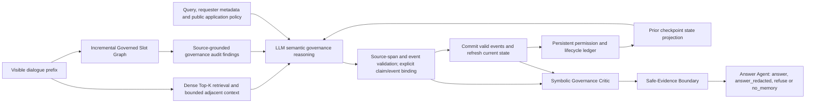

# Framework-to-code correspondence

This reference follows Fig. 2 of the October 16 manuscript, *Gov-Mem: Governance-Aware Neuro-Symbolic Memory Access and Reasoning for Multi-Principal Shared Memory Systems*. The figure appears on PDF page 6. It describes the current `govmem_v8_late_governance` execution path.

## Neuro-symbolic execution

The neural components extract source-grounded graph candidates, interpret natural-language governance, propose claim/event bindings, and generate answers from approved evidence. Deterministic components validate source spans and event bindings, maintain and project governance state, apply narrow symbolic vetoes, and construct the safe-evidence view.

**The Governed Slot Graph is present and enabled in the published Full configuration.** Its advisory role is part of the method: source-grounded graph warnings enter the language-governance reasoner and can affect semantic claim review. It is neither a disconnected visualization nor a direct authorization engine.

## Fig. 2 blocks and implementation

| Framework block | Implementation | Actual behavior |
|---|---|---|
| Observable input | [`data/adapters.py`](../src/gov_mem/data/adapters.py), [`extraction/v8_principal_registry.py`](../src/gov_mem/extraction/v8_principal_registry.py) | Load visible checkpoint history, requester metadata and source identities. Hidden evaluation fields are excluded from the runtime view. |
| Retrieval Backbone | [`GovMemV8LateGovernanceBackbone.run_instance`](../src/gov_mem/backbones/govmem_v8_late_governance.py), [`memory/dense_index.py`](../src/gov_mem/memory/dense_index.py) | Dense retrieval supplies Top-K source turns. `_expand_with_adjacent_context` supplies bounded neighboring context. |
| Governed Slot Graph | [`memory/governed_slot_graph.py`](../src/gov_mem/memory/governed_slot_graph.py), [`memory/v8_slot_graph.py`](../src/gov_mem/memory/v8_slot_graph.py) | An LLM proposes open-vocabulary slots, entities, relations, policy candidates and lifecycle observations. Source validation grounds proposals; the episode-local graph is incrementally cached. Changed or shortened prefixes reset incompatible graph state. |
| Graph Audit Context | [`_slot_graph_observer_audit`](../src/gov_mem/backbones/govmem_v8_late_governance.py), [`reason_v8_claims`](../src/gov_mem/governance_runtime/v8_claim_reasoner.py) | Explicit deny/revoke/permission-requirement and deletion findings are supplied under `governed_slot_graph_audit`, with `mode: advisory_only`. The LLM resolves relevance to the query, requester, scope and time. |
| Language Governance Reasoning | [`governance_runtime/v8_claim_reasoner.py`](../src/gov_mem/governance_runtime/v8_claim_reasoner.py), [`governance_runtime/v8_shallow_memory.py`](../src/gov_mem/governance_runtime/v8_shallow_memory.py) | Interpret semantic scope and propose field-level claims, delivery modes, explicit bindings and new permission/lifecycle events. The default uses the shallow JSON protocol. |
| Grounding & State Projection | [`extraction/v8_event_validator.py`](../src/gov_mem/extraction/v8_event_validator.py), [`extraction/v8_line_protocol.py`](../src/gov_mem/extraction/v8_line_protocol.py), [`governance_runtime/v8_event_store.py`](../src/gov_mem/governance_runtime/v8_event_store.py), [`governance_runtime/v8_state_projector.py`](../src/gov_mem/governance_runtime/v8_state_projector.py) | Validate source references and structural bindings. Commit valid events before refreshing the state used by the critic. The line-protocol module also implements binding checks used by JSON execution. |
| Symbolic Governance Critic | [`governance_runtime/v8_symbolic_critic.py`](../src/gov_mem/governance_runtime/v8_symbolic_critic.py) | Apply supported vetoes for explicitly bound active denial and deletion. Revocation is enforced through the projected deny state. Unknown graph edges do not automatically grant or deny access. |
| Safe-Evidence Boundary | [`governance_runtime/v8_safe_evidence.py`](../src/gov_mem/governance_runtime/v8_safe_evidence.py) | Release surviving source excerpts, remove blocked values/quotes from blocked-slot metadata, and mask restricted overlapping source spans. |
| Answer Agent | [`_answer_from_safe_evidence`](../src/gov_mem/backbones/govmem_v8_late_governance.py) | The supported-answer call receives approved claims and sanitized blocked-slot metadata together with the query/requester. Refusal and no-memory outcomes can be produced without an answer-generation call. |

## Exact graph behavior

The backbone executes `V8SlotGraphIndex.retrieve` when `memory_governed_slot_graph.enabled` is true. Graph construction uses the observable source prefix, excluding the current query turn identified by `as_of_turn_id`. It then summarizes explicit policy/deletion findings and passes them to `reason_v8_claims`.

The graph index computes query-matched entity/source proposals, but the current observer summary draws explicit warnings from the retained graph policy/lifecycle records. The language reasoner determines which findings apply to the requested field. Thus, graph audit context and factual retrieval candidates are separate inputs: graph-derived candidates do not take dense Top-K positions (`graph_selected=0`). A silent graph emits no advisory block; ordinary semantic reasoning, state projection and symbolic verification continue.

The Governed Slot Graph and persistent event ledger are also distinct. The graph stores source-grounded observations for advisory audit; the shallow event ledger tracks validated governance transitions for checkpoint-time state projection and symbolic verification. They should not be described as one graph that directly decides authorization.

## Configuration and verification

[`configs/govmem.yaml`](../configs/govmem.yaml) enables the graph, selects shallow memory and defaults to GPT-5.4-nano with temperature 0.0. The graph can be disabled for the corresponding ablation; this does not change the meaning of the Full configuration.

[`tests/test_framework_graph_path.py`](../tests/test_framework_graph_path.py) loads the published configuration and uses deterministic fake model responses to exercise real graph construction, advisory delivery into the shallow reasoner, and safe answer generation. It also verifies that graph silence preserves normal reasoning and that the current query turn is excluded from graph extraction. [`tests/test_v8_late_governance_backbone.py`](../tests/test_v8_late_governance_backbone.py) covers the graph's separation from factual candidates and additional grounding/state/boundary contracts. These tests verify execution contracts; they do not measure benchmark effectiveness.
